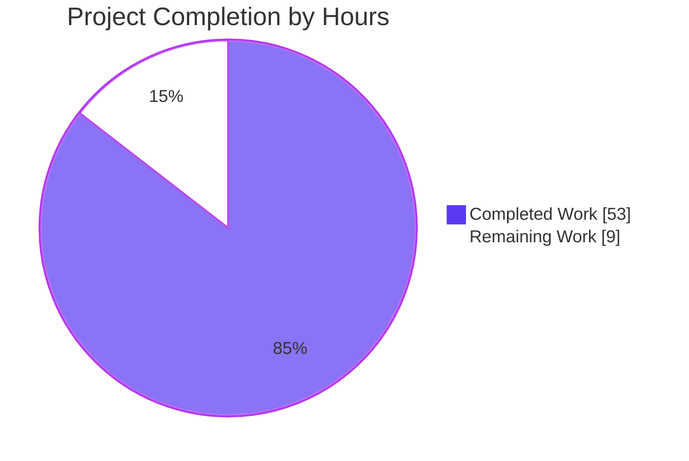
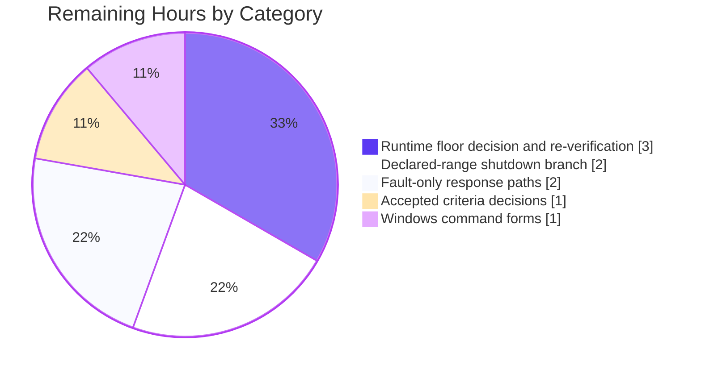

# 1. Executive Summary

## 1.1 Project Overview

A greenfield, single-file, zero-dependency Node.js HTTP server built as a teaching reference: one readable file, `server.js`, that starts with `node server.js`, answers `GET /hello` with `Hello world`, answers every other method or path with `Not Found`, logs one line per request, validates its `PORT`, reports bind failures actionably and shuts down cleanly on CTRL+C. Beside it sit a seven-field `package.json` with no dependency block and a `README.md` a beginner can follow to a clean exit. Its impact: a framework-free baseline showing how the built-in `http` module turns a request into a response.

## 1.2 Completion Status



| Metric | Hours |
| --- | --- |
| Total Hours | 62 |
| Completed Hours (AI + Manual) | 53 |
| Remaining Hours | 9 |
| Completion | **85%** — 53 / 62 |

All 53 completed hours are autonomous work; no manual hours are included.

## 1.3 Key Accomplishments

- ✅ `GET /hello` returns 200, `text/plain`, `Content-Length: 11`, `Hello world`; anything else returns 404 `Not Found`, verified on the wire and in a browser.
- ✅ Routing is an exact method-and-path conjunction; HEAD gets the 404 with no body.
- ✅ Matching is unnormalised and Host-independent: query strings are excluded, trailing slashes, case and percent-encoding are not.
- ✅ One ISO-8601 line per handled request, before the routing decision; stderr clean.
- ✅ `PORT` resolves once: unset defaults to 3000, 1024–65535 is accepted, anything else is refused before any socket call with exit 1.
- ✅ Lifecycle verified: the startup line, an EADDRINUSE diagnostic naming the port bound, and both stop lines with exit 0 on SIGINT.
- ✅ Median latency 0.14 ms against a 10 ms target, 50 simultaneous requests correct, RSS bounded and non-monotonic.
- ✅ Every `README.md` transcript matches the server's output, both entry points work, and the manifest carries seven fields only.

## 1.4 Critical Unresolved Issues

At the grain of the scoped requirement set — eleven functional requirements plus seven non-functional groups — **6 of 18 remain open or carry a caveat**:

| Issue | Impact | Owner | ETA |
| --- | --- | --- | --- |
| Declared runtime floor `engines.node ">=18.0.0"` admits end-of-life Node 18 releases (EOL 2025-04-30), including a remotely triggerable denial-of-service advisory in 18.0.0–18.19.0 | A reader on an old 18.x runs a runtime with known, unfixed advisories; the declaration is advisory, not enforced | Project owner | 3 h |
| The post-warm-up memory-stability band (±1 MB) is exceeded in some sustained runs (up to ~1.8 MB once preceding load is applied); bounded, non-monotonic, nothing retained per request | The stated criterion is unmet in those runs, not the behaviour; no code change is available inside the scope | Project owner | 1 h |
| The constant 500 containment response and the non-EADDRINUSE `Server error:` diagnostic are reachable only under an injected fault | A regression in either path would be caught by no current check | Project owner | 2 h |
| The Node 18.0/18.1 shutdown branch is unexercised: there an idle keep-alive client delays the second stop line until its keep-alive window expires | Part of the advertised runtime range is untested; the code guards the difference | Project owner | 2 h |
| The CONNECT catch-all reply omits the runtime-added `Date`, and its socket carries no application-set timeout | Minor protocol hygiene; a deliberately half-open peer can hold that socket | Project owner | 1 h (shared) |
| The README's two Windows `PORT` command forms cannot be executed on this Linux host | Platform coverage of the documentation is unverified | Project owner | 1 h |

## 1.5 Access Issues

| System/Resource | Type of Access | Issue Description | Resolution Status | Owner |
| --- | --- | --- | --- | --- |
| Default TCP port 3000 | Network port | Reserved by the shared build host, so the default-port path was exercised in an isolated network namespace instead of on the host | Resolved for validation — no production impact | n/a |
| cmd.exe / PowerShell | Shell environment | Absent from this Linux environment, so the two documented Windows command forms cannot be run here | Open — 1 h task | Project owner |

## 1.6 Recommended Next Steps

1. **[High]** Re-decide the runtime floor: raise `engines.node` and the README prerequisite to a supported release, then re-run the recorded gates (3 h).
2. **[Medium]** Verify the 500 containment response and the non-EADDRINUSE `Server error:` diagnostic with an injected fault (2 h).
3. **[Medium]** Exercise the Node 18.0/18.1 shutdown branch with an idle keep-alive client attached (2 h).
4. **[Medium]** Record the memory-stability band and the CONNECT reply's header and timeout profile as decisions (1 h).
5. **[Low]** Verify the two documented Windows `PORT` forms, or annotate them as unverified (1 h).

# 2. Project Hours Breakdown

## 2.1 Completed Work Detail

Every component below is delivered and verified; the hours reflect engineering effort including the verification of that component.

| Component | Hours | Description |
| --- | --- | --- |
| HTTP request path | 14 | `parsePathname`, `logRequest`, `sendPlainText`, `handleRequest`, `handleHello`, `handleNotFound` (`server.js:76-132`): target parsing against a fixed base with a null fallback, the single ISO-8601 request log line written before the routing decision, the method-and-path conjunction, the single response write point, and both contracted responses byte-exact (`Content-Length` 11 and 9). |
| Port resolution and validation | 5 | `resolvePort` and the port constants (`server.js:36-73`): the 3000 default only when `PORT` is unset, a digits-only integer within 1024–65535, the privileged-port refusal before any socket call with no bypass, and two actionable stderr messages with exit 1. |
| Process lifecycle | 6 | `startServer`, the server `'error'` listener, `stopServer` and `main` (`server.js:176-247`): the create → error → connect → listen → SIGINT registration order, the EADDRINUSE diagnostic naming the port actually bound, the idempotent shutdown with the `closeIdleConnections` version guard, and the 0/1 exit codes. |
| Catch-all completeness and robustness | 4 | The CONNECT socket answer with its `'error'` handling (`server.js:151-173`) so every method is answered, and the request-body discard at the head of the request path (`server.js:105`) that keeps a delivered body from being held. |
| Response containment and diagnostics hygiene | 4 | The `requestListener` wrapper with its constant 500 body and stderr-only diagnostic (`server.js:131-146`), and the neutralization of non-printing characters in the port diagnostics (`server.js:22,30-32`) so a crafted value cannot split a line or forge a log entry. |
| `package.json` manifest | 1 | The seven contracted fields with verbatim values, the two entry points, and no dependency block of any kind (`package.json`). |
| `README.md` documentation | 5 | The eight contracted topics over a replaced placeholder, with every startup, response, log, refusal and shutdown transcript byte-identical to what the server prints (`README.md`). |
| Acceptance verification | 14 | Execution of the project's own gate set against the running server: startup, both contracts, the routing and method matrix, logging discipline, the port matrix and both boundaries, EADDRINUSE, SIGINT (single and doubled), `npm start`, latency, concurrency, memory stability, and the documented walkthrough — each with its observable recorded. |
| **Total** | **53** | Matches the Completed Hours figure in Section 1.2 and the "Completed Work" value in Section 7. |

## 2.2 Remaining Work Detail

Each category traces to a scoped requirement or to a release-readiness need; nothing here is excluded work being reopened.

| Category | Hours | Priority |
| --- | --- | --- |
| Declared runtime floor: owner re-decision to a supported Node line, then re-verification of the acceptance gates on that line | 3 | High |
| Declared-range verification: exercise the Node 18.0/18.1 shutdown branch with an idle keep-alive client attached | 2 | Medium |
| Fault-only response paths: verify the constant 500 containment response and the non-EADDRINUSE `Server error:` diagnostic under an injected fault and record the observables | 2 | Medium |
| Accepted criteria: an owner decision plus a recorded, repeatable measurement for the memory-stability band and for the CONNECT reply's header and timeout profile | 1 | Medium |
| Windows command forms: verify the two documented cmd.exe / PowerShell `PORT` forms on those shells | 1 | Low |
| **Total** | **9** | Matches the Remaining Hours figure in Section 1.2 and the "Remaining Work" value in Section 7. |

# 3. Test Results

No test framework ships with this project by design — a zero-dependency, three-file deliverable has nothing to instrument and nothing to scan — so verification is carried in the project's own command-level gates, each exercised with its observable recorded. **81 checks were executed against the running server: 77 command-line checks across eight capability groups, plus 4 headless-browser navigations.** All 81 passed. Runtime: Node v22.23.3, npm 11.21.0, every instance started from this checkout on a private port and stopped by the pid it printed.

| Area / Category | Framework | Tests | Passed | Failed | Coverage | What This Proves |
| --- | --- | --- | --- | --- | --- | --- |
| Deliverable shape, manifest and static conformance | Command-level gate harness (`node --check`, `node -e`, `git ls-files`, absence probes) | 11 | 11 | 0 | n/a — no instrumentation exists | The tree is exactly the three deliverable files with every excluded path absent, the manifest carries the seven verbatim fields and no dependency block, nothing is imported but the built-in `http` module, and no placeholder, stub or prohibited call site exists. |
| HTTP contract, routing matrix and browser rendering | Gate harness (`node:http`, raw TCP sockets, `curl`) plus headless Chrome | 32 | 32 | 0 | n/a | Both contracted responses are byte-exact on the wire and in a browser (`Content-Length` 11 and 9, `text/plain`, no `Transfer-Encoding`, no injected markup), the match is a method-and-path conjunction, and path comparison is unnormalised, Host-independent and safe on an unparseable target. |
| Request logging and stream discipline | Gate harness over captured stdout/stderr | 3 | 3 | 0 | n/a | Exactly one ISO-8601 `<timestamp> <METHOD> <path>` line is written per handled request before the routing decision, stdout carries nothing else, and stderr stays empty on clean runs. |
| Port configuration matrix | Gate harness spawning short-lived instances | 14 | 14 | 0 | n/a | The default resolves to 3000 when `PORT` is unset, both boundaries serve, six invalid values and three privileged values are refused with the documented message, exit 1 and nothing bound, and a control character in `PORT` cannot split the diagnostic. |
| Bind failure and shutdown lifecycle | Gate harness with a held port and signal delivery | 4 | 4 | 0 | n/a | A second bind exits 1 naming the port actually bound with no startup line, and SIGINT produces both stop lines, exit status 0 and a released port — exactly once even under a doubled signal. |
| Response containment under an injected fault | Gate harness with a preloaded fault (`node -r`) | 2 | 2 | 0 | n/a | A failure inside the request path returns the constant `Internal Server Error` body with `Content-Length: 21`, keeps the diagnostic on stderr only, and leaves the process serving. |
| Entry points and the documented walkthrough | Gate harness plus `npm` and `bash` | 9 | 9 | 0 | n/a | `npm start` serves the same contract and stops cleanly through its node child with npm exiting 0, every documented POSIX command runs as written, and every documented transcript — startup, both responses, both refusals, shutdown — matches what the server prints. |
| Latency, concurrency and memory stability | Throwaway Node clients with keep-alive connection reuse, RSS sampling | 6 | 6 | 0 | n/a | 200 measured requests were 0 wrong at a 0.137 ms median (min 0.113, p95 0.214, max 0.325) against a 10 ms target, 50/50 simultaneous requests were correct, and six 250-request batches stayed in a bounded, non-monotonic band. |

**Not Covered**

- **The constant 500 containment response and its socket-destroy branch** (`server.js:131-146`) are unreachable by any request; they were exercised only under an injected fault, so a human should re-run them from a fault harness before release.
- **The non-EADDRINUSE `Server error:` diagnostic** (`server.js:213-216`) has no natural trigger in this environment, where the kernel permits binding the low ports the validator allows; verify it with an injected bind error.
- **The Node 18.0/18.1 branch of the declared runtime range** — where `closeIdleConnections` does not exist and an idle keep-alive client delays the second stop line until its keep-alive window expires (`server.js:190-195`) — is unexercised; only a newer runtime was available. Verify it on that release.
- **The two Windows `PORT` command forms** documented in `README.md:159` cannot be executed without cmd.exe or PowerShell; verify them there or annotate them as unverified.
- **The memory-stability band itself**: RSS was measured in every run and is bounded and non-monotonic, but the stated ±1 MB post-warm-up band is exceeded in some sustained runs, so the criterion — not the behaviour — still needs a decision.

# 4. Runtime Validation & UI Verification

Every flow below was driven against a server started from this checkout on a private port, with the result recorded from the run itself.

- ✅ **Startup** — `Server listening on port <resolved>` is the first stdout line, before any request; both range boundaries (1024 and 65535) bound and served, and an unset `PORT` resolved to 3000 in an isolated network namespace.
- ✅ **`GET /hello`** — 200, `Content-Type: text/plain`, `Content-Length: 11`, body exactly `Hello world`, a `Date` header, no `Transfer-Encoding`, and no header set by the application beyond content type and length.
- ✅ **Catch-all** — 404 with `Content-Length: 9` and body `Not Found` for every other method and path, including POST, PUT, PATCH, DELETE, TRACE and OPTIONS on `/hello`, and HEAD with the 404 status and headers and no body on the wire.
- ✅ **Path and target edges** — `/hello?x=1` and `/hello#f` match; `/hello/`, `/Hello`, `/%68ello` and `/` do not; an absolute-form target matches; an unparseable target is answered with the catch-all and the process keeps serving.
- ✅ **CONNECT** — a raw `CONNECT` request receives the byte-exact 80-byte catch-all answer (`HTTP/1.1 404 Not Found`, `text/plain`, `Content-Length: 9`, `Not Found`) in both path and authority form, and a client reset does not stop the process.
- ✅ **Request logging** — one ISO-8601 line per handled request on stdout, written before the response, with nothing else on stdout and stderr empty across the whole run (2,043 lines observed).
- ✅ **Configuration** — the override is honoured; six invalid values (`abc`, `3000.5`, `8e3`, empty, `70000`, `65536`) exit 1 with the documented message and nothing bound; three privileged values (`80`, `0`, `999`) are refused before any socket call; and a `PORT` carrying a control character yields a single neutered diagnostic.
- ✅ **Bind failure and shutdown** — a second bind exits 1 naming the port actually bound; SIGINT gives both stop lines, exit status 0 and a released port, exactly once under a doubled signal; `npm start` serves the same contract and its node child stops cleanly with npm exiting 0.
- ⚠ **Performance and stability** — median latency 0.137 ms and 50/50 concurrent requests correct; RSS bounded and non-monotonic, but the post-warm-up ±1 MB band is exceeded in some sustained runs with preceding load.
- ⚠ **Browser rendering** — both endpoints render as plain-text documents byte-exact, with no injected markup, zero `<script>` elements, and no console output from the application (only the browser's own notification of the contracted 404 responses).

Never exercised at runtime: the constant 500 containment response and its socket-destroy branch, the non-EADDRINUSE `Server error:` diagnostic, the Node 18.0/18.1 shutdown branch, and the two Windows command forms documented in the README. There is no user interface, page, asset or form to verify — the product's whole surface is one HTTP port serving two plain-text documents, and its request body handling was exercised with a 1 MB upload that was discarded and left the connection able to serve the next request.

# 5. Compliance & Quality Review

## 5.1 Compliance Matrix

| Deliverable / Requirement | Benchmark / Criterion | Status | Progress | Verified Evidence |
| --- | --- | --- | --- | --- |
| Three-file deliverable and layout | Exactly `server.js`, `package.json`, `README.md` at the root; every excluded artefact absent | ✅ Pass | 100% | `git ls-files` returns the three paths; all 20 excluded paths probed absent |
| `GET /hello` and catch-all response contracts | 200 / `text/plain` / `Content-Length: 11` / `Hello world`; 404 / `text/plain` / `Content-Length: 9` / `Not Found` for every other method and path | ✅ Pass | 100% | Byte-exact on the wire, over a raw socket, and rendered in a browser |
| Method-and-path routing and matching edges | Exact, case-sensitive conjunction on the parsed pathname; no normalisation; Host-independent | ✅ Pass | 100% | Six method mismatches 404; query and fragment match while trailing slash, case and percent-encoding miss |
| Per-request logging | One ISO-8601 `<timestamp> <METHOD> <path>` line per request, before route handling, nothing else | ✅ Pass | 100% | 2,043 consecutive well-formed lines; stdout carries nothing else; stderr empty |
| Port resolution, validation and refusal | Default only when unset; digits-only integer 1024–65535; privileged refusal with no bypass; actionable messages and exit 1 | ✅ Pass | 100% | Both boundaries serve; six invalid and three privileged values each exit 1 with the documented message and nothing bound |
| Bind-failure and fatal-error reporting | EADDRINUSE names the port actually bound; graceful exit 1; no stack trace | ✅ Pass | 100% | A second bind on a held port produced the exact documented line and exit 1 |
| SIGINT shutdown, idempotence and exit codes | Both stop lines, clean close, exit 0, once only | ✅ Pass | 100% | Observed with and without an idle client and under a doubled signal; port released each time |
| Response containment and information disclosure | Constant body on an unexpected failure; no internal detail in any response | ✅ Pass | 100% | The 500 body with `Content-Length: 21` under an injected fault; no internal marker in any response sweep |
| Manifest conformance and dependency minimalism | Seven verbatim fields; no dependency block; no lockfile, `node_modules` or toolchain file | ✅ Pass | 100% | Field dump verbatim; `npm ls --depth=0` empty; nothing written by any run |
| Documentation accuracy and completeness | Eight topics; every documented command runnable and every documented output matched | ✅ Pass | 100% | Startup, both response blocks, both refusal transcripts and the shutdown transcript reproduced exactly |
| Performance | Response latency under 10 ms; concurrent requests independent | ✅ Pass | 100% | Median 0.137 ms over 200 measured requests; 50/50 simultaneous requests correct |
| Resource stability and the declared runtime line | Stable memory under repeated requests; a true, supportable Node floor | ⚠ Partial | 85% | Bounded, non-monotonic RSS but the ±1 MB band is exceeded in some sustained runs; the declared floor admits end-of-life releases |

## 5.2 AAP & Rule Divergences and Gaps

Every divergence between what the plan and the request's constraints required and what was delivered is recorded below with its cause, its impact and what a human must decide.

| What The Plan Or Rule Required | What Was Delivered Instead | Why It Diverged | Impact | Remediation |
| --- | --- | --- | --- | --- |
| Thirteen components, with a single response write point for every response | A fourteenth unit, `connectListener`, writes the catch-all answer directly on the CONNECT socket (`server.js:151-173`) | A CONNECT request never receives an `http.ServerResponse`, so that contract row is deliverable only over the socket | None observable: the answer is byte-identical to every other catch-all answer and still logs one line | None required; a future revision of the specification could name the socket answer alongside `sendPlainText` |
| The 404 row lists a `Date` header | The CONNECT reply carries only `Content-Type` and `Content-Length` | `Date` comes from the runtime's response serializer, which a CONNECT request never passes through, and inventing headers is excluded | Minor protocol hygiene; a client reading `Date` from that reply will not find it | Owner decision (Section 2.2): accept the two-header profile, or revise the contract |
| The configuration diagnostics interpolate the configured value verbatim | The value is neutralized first — `NON_PRINTING_CHARACTERS` and `neutralizeControlCharacters` (`server.js:22,30-32,53,66`) | A `PORT` carrying a control character otherwise splits one diagnostic across stderr lines and can forge a log entry | A non-printing character in `PORT` renders as `?`; every documented transcript is unchanged | None required |
| Short comments only where the reason for a line is not obvious | A two-line comment sits over `request.resume();` (`server.js:103-104`) recording the deliberate body discard | The record of a deliberate decision has to live somewhere, and the request path is where a maintainer will ask why a body is read and dropped | One statement carries a slightly longer explanation than its neighbours | None required; reword only if a reader judges it excessive, keeping the recorded facts |
| The plan's Foundation wording: "every literal the program uses has a name" | Status codes, console strings and the module specifier stay inline, as the plan's own ten-constant list prescribes | The two statements conflict; the operative constant list governs and adding status constants would breach it | Documentation wording only; nothing about the code changes | Owner may reword the specification; the code is correct as it stands |
| `main` logs a configuration error and exits 1 | A `return;` follows the exit call (`server.js:239-241`) | Without it, an intercepted exit falls through to `startServer` with an unresolved port, which would bind an arbitrary ephemeral port | None; it makes the plan's own "otherwise `startServer(port)`" structurally true | None required |
| A lint step as part of the delivery process | `node --check server.js` plus static sweeps (declaration, constant-consumer, import, comment-stripped byte comparison, tab, trailing-whitespace and placeholder sweeps) | The project declares no packages and the plan excludes lint, format, type-check and build configuration, so no linter may exist | Consistency is a review criterion rather than a tool's job; the syntax and style sweeps stand in its place | None required |
| Post-warm-up RSS inside a ±1 MB band (the stated resource-stability criterion) | Bounded, non-monotonic RSS that exceeds the band in some sustained runs | RSS is the allocator's view of the process rather than the heap alone, and the only settlements — GC/heap or connection tuning, or a benchmarking harness — are explicitly excluded | The criterion is unmet in those runs; no request data is retained and no growth is monotonic | Owner decision (Section 2.2): restate the criterion as a bounded band with a measurement protocol, or accept it as measured |

**The CONNECT answer.** The plan fixes the file at thirteen units and names one write point, so a fourteenth unit answering CONNECT on a bare socket is a real departure — it is the only way the catch-all contract can hold for that request class, because the runtime hands a CONNECT request a socket instead of the request/response pair every other path uses (`server.js:148-173`). The behavioural properties the structural rule exists for are intact: status, content type, length and body come from the same constants, the answer is byte-identical, and the request still logs exactly one line. The socket `'error'` handler beside it is what keeps a client reset from stopping the process. Read the two write sites before changing either one.

**The CONNECT reply's header profile.** That same reply sets only `Content-Type` and `Content-Length`; it carries no `Date` and no `Connection`, because those are added by the runtime's response serializer, which a CONNECT request never reaches, and inventing headers is out of scope. The status, content type, length and body are exactly what the contract specifies, so nothing user-visible is missing; what a reader should know is that a client parsing that reply will not find a clock. Decide whether that profile is acceptable for your use, or whether the contract should be revised to state it explicitly.

**Neutralized configuration diagnostics.** The plan's sketch echoes the configured value verbatim into both refusal messages; the delivered code replaces every non-printing character with `?` first (`server.js:22,30-32,53,66`). The reason is concrete: a `PORT` containing a line feed otherwise makes one diagnostic arrive as two stderr lines, which can forge an entry in any captured log. The message text, the surrounding quotes and the exit status are unchanged, and because every documented value is ASCII every quoted transcript is still byte-identical. Nothing is required of a reader here beyond knowing that the echoed value is now one line by construction.

**The comment over the request-body discard.** Two comment lines sit above `request.resume();` (`server.js:103-104`) to record why the request path reads and discards a body it never parses, logs or keeps. That is longer than the surrounding style, and the record is deliberate: without it a later reader would reasonably delete the line and reintroduce the unconsumed-body behaviour it exists to prevent. If you judge the wording excessive, shorten it — but keep the fact, because the code is the only place it is written down. No behaviour depends on the comment.

**"Every literal has a name."** The plan's completion wording claims every literal in the program is named, while the same plan's operative constant list names exactly ten constants and excludes status codes and console strings, which therefore stay inline. The code follows the constant list, so the divergence is in the specification's summary sentence rather than in the deliverable. Nothing about the running server changes either way; if the wording matters to you, amend it where the specification lives rather than adding declarations the constant list does not include.

**The `return;` after `process.exit(1)`.** The plan's sketch shows only a log and an exit in `main`'s catch; the delivered code adds a `return;` (`server.js:239-241`) with a one-line reason. It looks like dead code and is not: it is what keeps the plan's own "otherwise `startServer(port)`" literally true, because a process whose exit is intercepted would otherwise fall through and bind an arbitrary port for a value that was already rejected. Nothing needs to be done about it; do not remove it as redundant.

**The linter step.** The delivery process expects a lint pass, and this project cannot have one: it declares no packages, and the plan excludes linting, formatting, type-checking and build configuration outright. The substitution is a syntax check plus static sweeps that cover declaration counts, constant consumers, the single import, comment-stripped byte comparison against the previous revision, tabs, trailing whitespace and placeholders. The consequence for you is that style consistency rests on review rather than on a tool — worth knowing if you add files to this project later.

**The memory-stability criterion.** The acceptance criterion asks for a post-warm-up RSS within ±1 MB; ordinary runs sit inside that band, but sustained runs with preceding load have measured up to roughly 1.8 MB of movement. It is bounded, non-monotonic, retains nothing per request, and appears just as strongly on revisions whose executable code is byte-identical — it is allocator reclamation timing around a ~59 MB level, not a leak. The only remedies the scope allows for are excluded, so this needs a decision from you: restate the criterion as a bounded band with a measurement protocol, or accept the behaviour as measured.

# 6. Risk Assessment

These are forward-looking: what could still go wrong once this server is used.

| Risk | Category | Severity | Probability | Mitigation | Status |
| --- | --- | --- | --- | --- | --- |
| The declared runtime floor `engines.node ">=18.0.0"` admits end-of-life Node 18 releases — including a remotely triggerable denial-of-service advisory in 18.0.0–18.19.0 and unfixed request-smuggling issues below 18.20.1 — and the declaration is advisory rather than enforced | Security | High | Medium (only when an old 18.x is used) | Raise `engines.node` and the README prerequisite to a supported line and re-run the recorded gate commands on it; the code needs no change | Open — owner decision (3 h) |
| The constant 500 containment response and the non-EADDRINUSE `Server error:` diagnostic are not reachable by any request, so a regression in either would be caught by no current check | Operational | Medium | Low–Medium | Exercise both under an injected fault and keep the harness outside the deliverable | Open (2 h) |
| No automated regression guard exists: no test framework, linter, type-check or CI, by design for a zero-dependency teaching artefact | Operational | Medium | Medium | Keep the documented gate commands as the release checklist for any change, or add a harness outside the three-file deliverable | Open |
| Cleartext HTTP, bound on every interface, with no authentication and no TLS | Security | Medium | Low for a local teaching artefact, higher if it is ever exposed | Run it on a trusted network, or place it behind a reverse proxy if it must be reachable; adding TLS, a `HOST` setting or authentication would breach the project's stated scope | Accepted by design |
| The post-warm-up RSS spread exceeds the ±1 MB band the acceptance criterion states in some sustained runs, though it is bounded, non-monotonic and retains nothing per request | Technical | Low | Medium | Restate the criterion as a bounded band with a recorded measurement protocol, or accept the measured behaviour | Open — owner decision (1 h) |
| The Node 18.0/18.1 branch of the declared range is unexercised: there an idle keep-alive client delays the second stop line until its keep-alive window expires, up to about five seconds | Technical | Low | Low–Medium | Run the shutdown branch on that release with an idle client attached and confirm the two stop lines and exit 0 within the bound | Open (2 h) |
| The CONNECT reply carries no `Date` header and its socket carries no application-set timeout, so a deliberately half-open peer can hold that one connection | Technical / Integration | Low | Low | Accept the profile explicitly, or revise the contract if a client needs a clock or a bounded socket lifetime | Open — accepted with a decision (1 h) |

No integration risk applies to this product: it has no external service, database, credential, message broker or outbound call, and its only interface is the HTTP port it listens on.

# 7. Visual Project Status

Completion by hours, with Completed Work in Blitzy dark blue (`#5B39F3`) and Remaining Work in white (`#FFFFFF`) against a violet-black stroke (`#B23AF2`):


**85% complete** — 53 of 62 hours. Remaining work by category (from Section 2.2):



**Remaining work by priority:** High 3 h (the declared runtime floor), Medium 5 h (declared-range verification 2 h, fault-only response paths 2 h, accepted-criteria decisions 1 h), Low 1 h (Windows command forms).

# 8. Summary & Recommendations

What was delivered is a complete, working artefact: one 247-line `server.js` that resolves and validates its port, serves `GET /hello` with `Hello world` and every other method or path with `Not Found`, logs exactly one ISO-8601 line per handled request, reports a bind failure actionably, and shuts down cleanly on CTRL+C; a seven-field `package.json` with no dependencies at all; and a `README.md` an untutored reader can follow from prerequisites to that clean exit. Nothing about it is scaffolding — no placeholder, no stub, no unfinished marker, no unreachable declaration — and every transcript the README quotes is one the server actually prints.

It is also verified rather than merely present. Both response contracts are byte-exact on the wire and in a browser; the method-and-path match, the path-matching edges, the logging discipline, the port matrix with both boundaries and both refusal messages, the EADDRINUSE diagnostic, single and doubled SIGINT, `npm start`, the documented walkthrough, latency at 0.137 ms median against a 10 ms target, 50 concurrent requests, and memory stability across repeated batches were each exercised with the result recorded. The one thing absent from that list is the exception rather than the rule: the constant 500 containment response and the non-EADDRINUSE server-error diagnostic cannot be reached by any request and were exercised only under an injected fault, so a regression in either would not be caught today.

The project stands at **85% complete — 53 of 62 hours**. The gap is not missing code: it is nine hours of verification and decisions. The declared runtime floor is the only item with release consequences — `engines.node ">=18.0.0"` advertises a line that reached end of life in April 2025 and admits releases carrying a remotely triggerable denial-of-service advisory — and until that is re-decided, the honest position is that the server is production-ready as a local reference implementation but should not be exposed on an old Node 18 runtime. The remaining hours close the four verification gaps (the two fault-only paths, the 18.0/18.1 shutdown branch, the two Windows command forms) and record two accepted criteria (the memory band and the CONNECT reply's header profile).

The critical path to production is short and needs no new code: raise the declared runtime line to a supported release and re-run the recorded gate commands on it (3 h), verify the fault-only response paths under an injected fault (2 h), exercise the declared range's shutdown branch (2 h), record the two accepted criteria as decisions (1 h), and verify the documented Windows command forms or annotate them (1 h). None of those five items changes a single line of executable behaviour; the order matters only in that the runtime decision determines which line the other verifications are run against.

Success metrics, all met: both contracted endpoints byte-exact, one log line per request, no internal detail in any response, latency three orders of magnitude inside the target, concurrency without blocking, a dependency set that is empty by construction, three files and not one more, and a documented walkthrough that runs as written. On those metrics this is production-ready as the teaching reference it was commissioned to be, and the one follow-up worth an owner's attention is the runtime-floor decision recorded above.

# 9. Development Guide

## System Prerequisites

- **Node.js 18.0.0 or newer** — the floor declared in `package.json` (`engines.node: ">=18.0.0"`) and stated in the README. Every API the server uses exists at that release. The verification recorded throughout this guide was run on Node v22.23.3 with npm 11.21.0.
- No other runtime, service, database, container or credential is required. There is no compiler, bundler or build step: plain CommonJS is executed as written.
- A POSIX shell for the commands below. On Windows the commands run as shown except the environment-variable override, whose cmd.exe and PowerShell forms are given under Configuration.

## Environment Setup

No setup is needed beyond having Node.js installed. The project is self-contained in one directory:

```bash
cd /path/to/your/checkout     # the directory holding server.js, package.json and README.md
node --version                # must report v18.0.0 or newer
```

## Dependency Installation

**There is nothing to install.** The manifest declares no dependencies, imports only the built-in `http` module, and writing a lockfile records nothing — do not commit one.

```bash
npm ls --depth=0              # prints the project name followed by an empty tree
```

Expected output:

```text
nodejs-tutorial-hello-world@1.0.0 /path/to/your/checkout
└── (empty)
```

## Application Startup

Run it in the foreground; it prints one line and then serves:

```bash
node server.js
```

```text
Server listening on port 3000
```

The number is the resolved port — `3000` when `PORT` is unset, otherwise the value of `PORT`. To run it on another port, or through npm (which executes the same command):

```bash
PORT=4000 node server.js
npm start
```

`npm start` prints npm's banner and the script echo before the startup line. There is no service to start first and no background daemon to manage; leave the process in the foreground and stop it with CTRL+C.

## Verification Steps

Run these against a running instance; each is the observable that proves a corresponding behaviour.

```bash
# both contracted responses
curl -s -i http://localhost:4000/hello          # 200, text/plain, Content-Length: 11, Hello world
curl -s -i http://localhost:4000/not-a-route    # 404, text/plain, Content-Length: 9, Not Found
curl -s -i -X POST http://localhost:4000/hello  # 404 — the method is part of the match
curl -s -i http://localhost:4000/hello?x=1      # 200 — a query string is not part of the path

# latency from a fresh connection (well under the 10 ms target)
curl -s -o /dev/null -w 'status=%{http_code} starttransfer=%{time_starttransfer}s\n' http://localhost:4000/hello

# the configuration refusals: both exit 1 and bind nothing
PORT=abc node server.js; echo "exit=$?"
PORT=80 node server.js;  echo "exit=$?"
```

Expected configuration output:

```text
Configuration error: invalid PORT "abc". Set PORT to an integer between 1024 and 65535.
exit=1
Configuration error: invalid PORT "80". Ports below 1024 are privileged and require root or CAP_NET_BIND_SERVICE; set PORT to an integer between 1024 and 65535.
exit=1
```

Shutdown, and the manifest check:

```bash
node server.js & PID=$!      # note the pid
kill -INT "$PID"; wait "$PID"; echo "exit=$?"
```

```text
Received SIGINT. Stopping server.
Server closed. Exiting.
exit=0
```

```bash
node -e 'const p=require("./package.json"); console.log(p.name, p.version, p.main, p.scripts.start, p.engines.node)'
```

```text
nodejs-tutorial-hello-world 1.0.0 server.js node server.js >=18.0.0
```

## Example Usage

With the server running on port 4000, a full exchange looks like this:

```bash
$ curl -s -i http://localhost:4000/hello
HTTP/1.1 200 OK
Content-Type: text/plain
Content-Length: 11
Date: Tue, 20 Oct 2026 01:08:23 GMT
Connection: keep-alive
Keep-Alive: timeout=5

Hello world
```

and the server's stdout grows by exactly one line per request:

```text
Server listening on port 4000
2026-10-20T01:08:23.713Z GET /hello
2026-10-20T01:08:23.719Z GET /not-a-route
```

Opening the same URL in a browser shows the plain-text document, because that is the content type the server sets.

## Configuration

`PORT` is the only setting the program reads, once, at startup.

| `PORT` | Behaviour |
| --- | --- |
| unset | `3000` |
| `1024`–`65535` | that port is used |
| anything else | configuration error on stderr, exit `1`, nothing bound |

An empty `PORT` is an invalid value, not the default, and no flag or variable bypasses the privileged-port refusal. On Windows the override is `set "PORT=4000" && node server.js` in cmd.exe (the quotes keep the space before `&&` out of the value) or `$env:PORT=4000; node server.js` in PowerShell; everything else — the default, the range, the refusal and the messages — is the same on every platform.

## Troubleshooting

| Symptom | Cause | Resolution |
| --- | --- | --- |
| `Error: cannot bind to port <n> (EADDRINUSE: address already in use)…` and exit 1 | Something already holds that port — often a previous instance of this server | Stop the other process, or start this one with a different `PORT` |
| `Configuration error: invalid PORT "<value>"…` and exit 1 | The value is not a whole number in 1024–65535, or it is empty | Use a digits-only value in range; quote it if your shell would otherwise expand it |
| The prompt returns `130` instead of `0` after CTRL+C | You started the server with `npm start`: CTRL+C signals the whole foreground process group, so npm — not the server — reports its own status | Expected; the server still prints both stop lines and frees the port. To see `0`, run `node server.js`, or signal the `node` child directly |
| A `SIGINT` sent to the npm pid leaves the port bound | npm does not forward a one-off signal to its child | Signal the `node` child process, or start with `node server.js &` when you need to signal it from another shell |
| The second stop line is slow to appear (up to about five seconds) with a client attached | On Node 18.0/18.1 an idle keep-alive connection is released only when its keep-alive window expires | Expected on those releases; newer runtimes close idle connections immediately |
| Nothing appears in the log for a request | The runtime rejected the request before the listener ran (a malformed request line, for example), so the application never saw it | Send a well-formed HTTP/1.1 request; the log records every request the server handles |

# 10. Appendices

## Appendix A — Command Reference

| Purpose | Command | Expected result |
| --- | --- | --- |
| Parse check (no build step exists) | `node --check server.js` | exit 0, no output |
| Start the server | `node server.js` | `Server listening on port 3000` |
| Start on another port | `PORT=4000 node server.js` | `Server listening on port 4000` |
| Start through npm | `npm start` | npm banner, then the startup line |
| Call the matched route | `curl -s -i http://localhost:4000/hello` | `200`, `text/plain`, `Content-Length: 11`, `Hello world` |
| Call the catch-all | `curl -s -i http://localhost:4000/not-a-route` | `404`, `text/plain`, `Content-Length: 9`, `Not Found` |
| Method mismatch | `curl -s -i -X POST http://localhost:4000/hello` | `404` with `Not Found` |
| Query string is not part of the path | `curl -s -i http://localhost:4000/hello?x=1` | `200` with `Hello world` |
| Latency from a fresh connection | `curl -s -o /dev/null -w '%{http_code} %{time_starttransfer}\n' http://localhost:4000/hello` | `200` and a first-byte time far under 10 ms |
| Refuse an invalid port | `PORT=abc node server.js; echo "exit=$?"` | the range message and `exit=1` |
| Refuse a privileged port | `PORT=80 node server.js; echo "exit=$?"` | the privileged-port message and `exit=1` |
| Stop the server by pid | `kill -INT "$PID"; wait "$PID"; echo "exit=$?"` | both stop lines and `exit=0` |
| Stop the server from the console | CTRL+C in the foreground | both stop lines, prompt returns |
| Inspect the manifest | `node -e 'const p=require("./package.json"); console.log(p.name, p.version, p.main, p.scripts.start, p.engines.node)'` | the five values verbatim |
| Confirm the empty dependency set | `CI=true npm ls --depth=0` | the project name and `└── (empty)` |

## Appendix B — Port Reference

| Port | Role |
| --- | --- |
| `3000` | Default when `PORT` is unset |
| `1024`–`65535` | Accepted range, inclusive; both boundaries verified to bind and serve |
| below `1024` | Refused in the configuration check, before any socket call, with no bypass |
| any other port | Whatever you set `PORT` to; the startup line names the resolved value |
| no dedicated port | There is no metrics, health or admin port — the listening port is the whole surface |

## Appendix C — Key File Locations

| Path | Contents |
| --- | --- |
| `server.js` | The entire application: constants (`1-32`), `resolvePort` (`36-73`), `parsePathname` (`76-83`), `logRequest` (`86-88`), `sendPlainText` (`92-98`), `handleRequest` (`102-119`), both route handlers (`122-129`), `requestListener` (`133-146`), `connectListener` (`151-173`), `stopServer` (`176-196`), `startServer` (`200-228`), `main` and its invocation (`232-247`) |
| `package.json` | The seven manifest fields; no dependency block |
| `README.md` | Purpose, prerequisites, installation, running, testing, expected output, shutdown and port configuration |

## Appendix D — Technology Versions

| Component | Version in use | Requirement |
| --- | --- | --- |
| Node.js | v22.23.3 | `>=18.0.0` (declared in `engines.node`) |
| npm | 11.21.0 | any version able to read the manifest |
| Built-in modules | `node:http` only | no third-party package at all |
| Globals used | `process`, `console`, `URL`, `Buffer` | available at the declared floor |

## Appendix E — Environment Variable Reference

| Variable | Required | Default | Accepted values | Effect |
| --- | --- | --- | --- | --- |
| `PORT` | No | `3000` (only when unset) | a digits-only integer from `1024` to `65535` | The port the server listens on; read once at startup |

No other environment variable, secret, credential or configuration file is read: `process.env` is touched for `PORT` alone.

## Appendix F — Developer Tools Guide

This project deliberately ships no toolchain: no linter, formatter, type checker, bundler, test runner or coverage tool. That was a stated constraint, not an omission — a zero-dependency, three-file teaching artefact has nothing to instrument. The checks that stand in their place, and that were run throughout the verification recorded in this guide, are:

- `node --check server.js` for a parse check, since CommonJS runs as written;
- `CI=true npm ls --depth=0` to confirm the dependency set is still empty;
- the command table in Appendix A as the regression checklist — the contract, the routing matrix, the logging line, the port matrix, the bind failure and the shutdown are all observable from it;
- a marker sweep for unfinished-work vocabulary, and a formatting sweep (tabs, trailing whitespace, declaration and constant-consumer counts), for stylistic consistency.

If you later add files or behaviour, consider a harness **outside** the three-file deliverable so the project keeps the shape its readers expect.

## Appendix G — Glossary

| Term | Meaning in this project |
| --- | --- |
| Catch-all | The 404 `Not Found` response for every request that is not exactly `GET /hello` |
| Containment path | The wrapper around the request path that logs a failure to stderr and answers a constant `Internal Server Error`, or destroys the socket when headers were already sent |
| `EADDRINUSE` | The error code the runtime raises when the configured port is already held; reported with the port actually being bound, then exit 1 |
| Keep-alive | A connection reused for more than one request; the runtime's keep-alive window is 5 s and is left at its default |
| Normalisation | Rewriting a request path — trailing slash, case, percent-encoding — before matching; this server deliberately does none |
| Resolved port | The value `PORT` is turned into: the configured number, or 3000 when `PORT` is unset |
| SIGINT | The signal CTRL+C sends; the server logs both stop lines, closes the listener and exits 0, once only |
| Unparseable target | A request target the URL parser rejects; answered with the catch-all 404 and logged as received |
